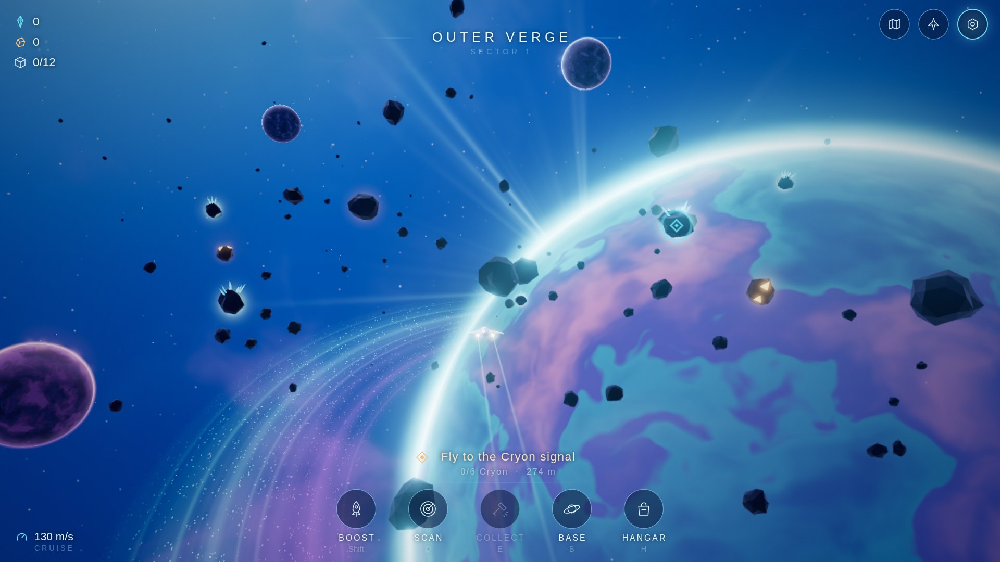
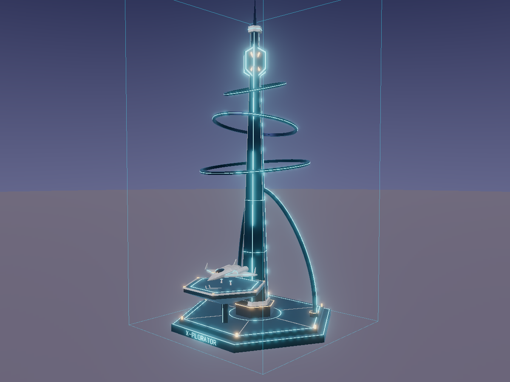
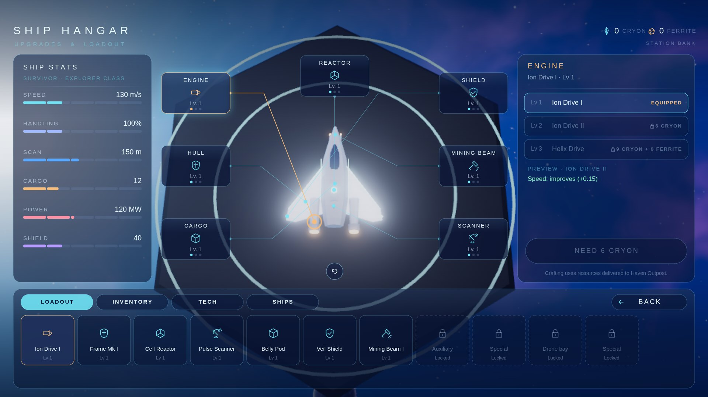
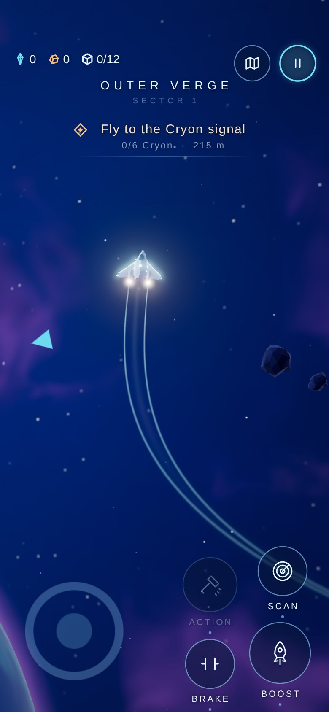
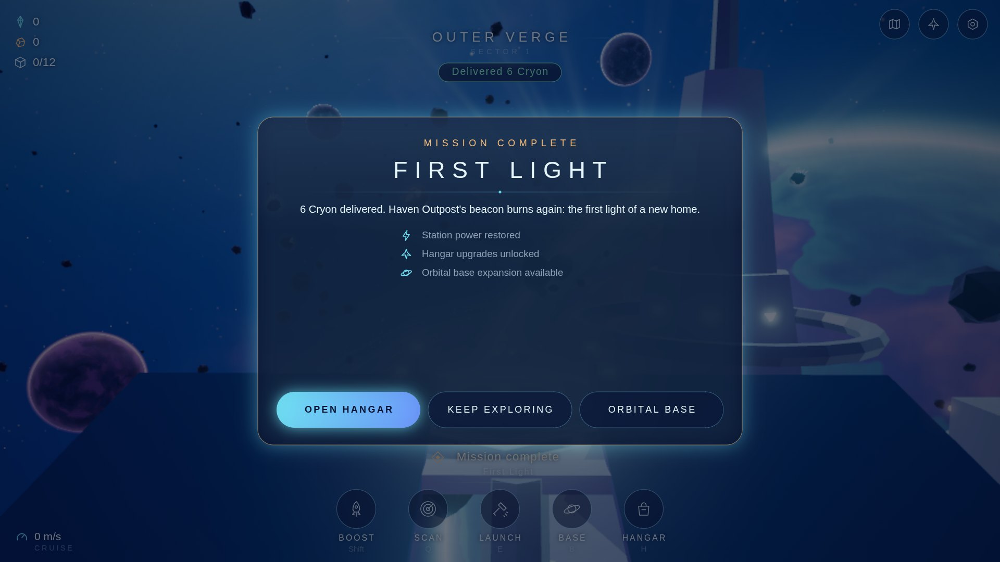

# Morning report: THE X-PLORATOR M1 "Outer Verge" (night of 23→24 Oct 2026)

Good morning! **You have a genuinely playable first version.** It runs in your browser and inside
Project 0's official sandbox, on desktop and phones. It passes Project 0's server validation for
lot #323. **Nothing was published**, no ATT was touched and lot #696 (STARBOX) was never modified.



## What was completed

**The game (src/, a Project 0 experience module that also runs standalone)**

- **One beautiful sector in the locked IMG 07 style, all generated in code:**
  - a cobalt / indigo / violet nebula sky (baked once into a cube map);
  - a giant shader-painted planet with teal, lilac and rose continents, a luminous cyan limb,
    an atmosphere halo, a sparkling orbital ring and god rays;
  - three moons, star specks and drifting space dust;
  - sparse faceted asteroids, glowing Cryon crystal clusters and gold Ferrite ore nodes;
  - the hexagonal Haven Outpost station.
- **A small original white ship**, built from code, with 7 equipment sockets. Module levels change
  the visible geometry: engine nacelles grow, a third engine appears, the scanner dish, cargo pods,
  shield nodes, mining prongs and wing fins all change. Ribbon contrails trace IMG 07's graceful
  curve.
- **Distant cinematic camera** (no close chase view). The ship's measured on-screen size is
  **6.1 %** of the view height on desktop and **8.0 %** on phones in portrait and landscape, inside
  your 4-9 % and 5-11 % targets. It is measured from the rendered ship, not assumed. The camera
  follows with soft lag, look-ahead and framing away from the planet. Optional free-look recentres
  on release, and zoom eases back to wide.
- **Simple, relaxing flight**:
  - one stick, WASD or left thumb steers;
  - auto-cruise flies you;
  - boost and brake are optional;
  - automatic banking and gentle auto-level;
  - a soft boundary assist brings you home.
- **The complete loop works: EXPLORE → SCAN → COLLECT → RETURN → DOCK → COMPLETE → UPGRADE.**
  Mission "First Light":
  1. Scan and mine two crystal asteroids (6 Cryon).
  2. Return and dock on the pad.
  3. The station beacon lights up and the "Mission complete" panel opens.
  4. Craft and equip upgrades in the hangar with the delivered Cryon.
  5. Nodes regrow, so free exploration continues.
- **Screens, following your layouts in IMG 07 colours:**
  - **Main menu:** Continue, New Journey, Galaxy Map, Settings. The menu sits on the left and the
    planet fills the right, as in IMG 01.
  - **Begin the Exodus:** Survivor FREE, Pioneer 2 ATT, Colony Ship 5 ATT and Exodus Vessel
    10 ATT, as real 3D ships. Paid ships are *locked demo placeholders* with no payment code.
  - **Ship Hangar** (IMG 03): a large top-down ship with 7 socket callouts and leader lines to the
    real socket positions; stats with upgrade previews (▲/▼); levels, equip and craft costs in game
    resources; Loadout / Inventory / Tech / Ships tabs; locked slots; drag to rotate and reset view.
  - **Galaxy map:** 9 procedural sectors from your planet generator, routes, pan and zoom, planet
    profiles. Only the Outer Verge is open.
  - **Orbital base builder** (IMG 04): a hex grid with a valid/invalid ghost, a module tray, costs
    in Ferrite and Cryon, and placement saved. The Scanner Array really adds scan range.
  - **HUD:** resources, sector, objective with distance, waypoint marker, off-screen arrows,
    prompts, scan cards and toasts.
  - **Pause, Settings and Controls help.** Settings cover quality, handling (Tranquil or
    Responsive), auto-cruise, invert, sensitivity, camera distance, reduced motion, sound, music and
    full **key rebinding**.
- **Platforms:**
  - **Desktop:** keyboard and mouse, primary target.
  - **Xbox-style controller:** your exact mapping (LS steer, RT boost, LT brake, RS optional look,
    A interact, X scan, Y map, Start pause).
  - **Phones in portrait AND landscape:** a floating stick, Boost, Brake, Scan and Action buttons,
    drag to look, and adapted camera, HUD and menus. There is no rotate-device wall.
- **Saves** through Project 0's per-player save (`p0.saved` / `p0.save`). They are validated on load
  and kept under 16 KB. The standalone version saves in the browser.
- **Original synthesised audio**: a calm ambient pad plus scan, collect, dock and launch cues.
- **Quality and performance:**
  - High, Medium and Low presets, chosen automatically.
  - Software-renderer detection for Project 0's review.
  - Shader warm-up so nothing compiles mid-flight.
  - Dynamic resolution.
  - NaN-safe bloom (a black-screen bug was found and fixed this way).

**Lot #323 street build (lot/)**: a slender indigo launch beacon with neon strips, three turning
orbital rings, an X-in-hexagon emblem, a docking deck with a hovering explorer, and stroke-built
"X-PLORATOR" lettering. It has LOD0, LOD1 and LOD2, live neon shaders and a `build.js` animation.
It sits within all budgets: LOD0 has 19,264 of 70,000 triangles.



**Repository work:**

- An integration branch that combines PR #2, #6 and #4 (no overlapping files) with no force pushes.
- Shared modules renamed `.mjs` → `.js` because Project 0 packages require it.
- A verified Project 0 API audit, documentation and test tooling.

## How to play

```sh
cd ~/The-X-plorator
git checkout dev/m1-outer-verge      # already checked out
LD_LIBRARY_PATH= npm install         # first time only (already done tonight)
npm start
```

Then open **http://127.0.0.1:5500/** in your browser. Add `?fresh=1` to start from scratch, and
press `Ctrl+C` in the terminal to stop the server. To play on your phone on the same Wi-Fi, run
`npm start -- --host 0.0.0.0` and open `http://<your PC's IP>:5500/`. Find the IP with
`hostname -I`.

To run it in **Project 0's official dev kit** (the real sandbox, nothing published), keep
`npm start` running and open:
`https://project0.city/devkit?entry=http://localhost:5500/main.js&width=16&depth=16&height=30`
(add `&phone=1` for the phone view).

More detail is in [RUN.md](RUN.md). The `LD_LIBRARY_PATH=` prefix works around this machine's
inherited AppImage library path, which breaks TLS in git and Chromium.

## Controls

| | Keyboard & mouse | Controller | Touch |
|---|---|---|---|
| Fly forward | automatic (auto-cruise) | automatic | automatic |
| Steer | W A S D / arrows | left stick | left thumb, anywhere on the left half |
| Boost | Shift or Space | RT (or RB) | hold BOOST |
| Brake / stop | C | LT | hold BRAKE |
| Scan | Q | X | SCAN |
| Collect / dock / launch | E | A | ACTION (lights up when available) |
| Galaxy map | M | Y | map button (top right) |
| Hangar / Orbital base | H / B | d-pad ◀ / ▶ | pause menu |
| Pause | P (Esc too, standalone only) | Start | pause button (top right) |
| Look around (optional) | right-drag | right stick | drag on the right half |
| Zoom (eases back) | mouse wheel, + / − | d-pad ▲ / ▼ | none |
| Menus | arrows + Space/E/Enter, Backspace = back | stick/d-pad + A, B = back | tap |

All keys can be rebound in **Settings → Keyboard bindings**.

## Visual results (real renders of the running game)

All images below are screenshots of the running game, captured by `tools/capture-suite.sh` and
`tools/play-loop.mjs`. None are concept art.

| | Files |
|---|---|
| Desktop 1920×1080 | `docs/media/m1/desktop-1920-{menu,select,flight,turn,hangar,base,map,pause}.jpg` |
| Desktop 1280×720 | `docs/media/m1/desktop-1280-{menu,flight,hangar}.jpg` |
| Phone portrait 390×844 | `docs/media/m1/phone-portrait-{menu,select,flight,steer,pause,hangar}.jpg` |
| Phone landscape 844×390 | `docs/media/m1/phone-landscape-{menu,select,flight,steer}.jpg` |
| The full loop (1920×1080) | `docs/media/m1/loop-0{1..8}-*.jpg` (launch → scan → mine → return → dock → complete → hangar → upgraded) |
| Project 0 dev kit | `docs/media/devkit/*.jpg` + JSON reports |
| Lot #323 beacon | `docs/media/lot323/*.png` (13 local renders of LOD0/1/2) |

| Hangar (IMG 03 layout) | Phone portrait | Mission complete |
|---|---|---|
|  |  |  |

## Tests

| Test | Result |
|---|---|
| `npm test`: 36 unit tests (flight, gamepad, touch, planet generator, mission loop, save sanitising and the 16 KB limit, hex base rules, ships, sector determinism, ID-less multitouch, key rebinding, flight presets, camera framing) | **36 pass, 0 fail** |
| `npm run playtest -- --hangar`: the whole loop flown with **real keyboard input** (no teleports or state setters), then crafting and equipping Ion Drive II | **PASS**, about 130 s, 0 errors (1600×900, 1280×720 and 1920×1080) |
| Official Project 0 dev kit, desktop | started, **0 errors**, `p0.save` works |
| Dev kit `devkit.review(14)` (the review's 640×360 and simulated keys), desktop with 2 players and phone | **14 s at 59.4 fps**, worst frame 27.6-30.6 ms, 0 errors |
| Dev kit touch (real CDP touch, phone view): menus by tap, **two fingers at once** (stick + Boost), pause | **works**. P0 pointer events are `t,k,x,y,dx,dy,buttons,button,touch` with no pointer id |
| Dev kit controller (`tools/devkit-pad.mjs`, simulated standard gamepad): d-pad + A menus, left stick + RT, X scan, Start pause | **works** (two consecutive runs, 0 errors) |
| Project 0 **server validation**, experience package (lot 323), final commit | **HTTP 200, ok, 0 errors, 0 warnings** (candidate `1e6872511b494c7c`) |
| Project 0 **server validation**, street build LOD0/1/2 (lot 323) | **HTTP 200, ok, 0 errors, 0 warnings** |
| Local package rule checks (`npm run package`) | OK (44 files, 305 KB JS, 1.3 MB zip) |
| Frame rate, active flight, standalone GPU Chromium on this PC (Intel HD Graphics 6000) | 1920×1080 High **51.2 fps** (p95 33 ms) · 1280×720 High **53.9 fps** · 390×844 phone emulation Medium **60.1 fps** |
| **Not executed** | physical phone, Xbox, Project 0's software-renderer review, two real accounts in the live city, the content review (it happens only on publish) |

## GitHub

- **Repository:** https://github.com/fottokarll/The-X-plorator
- **Branch:** `dev/m1-outer-verge`. It is pushed and `main` is untouched. PRs #2, #4 and #6 are left
  open; their commits are included.
- **Draft Pull Request: https://github.com/fottokarll/The-X-plorator/pull/9**
- **Commits** (newest first):
  - `8a5e5e9` confirm guard after screen changes; controller verified in the dev kit
  - (later commits: obstacle-avoidance assist and docking readout; see `git log`)
  - `ca7aeab` final real-render screenshots, loop and dev kit evidence
  - `1d86270` original synthesised ambient music and action cues
  - `3bc32aa` camera framing by largest projected extent, docs
  - `ec50008` planet-facing menu camera and screenshot suite
  - `a8ce972` verified touch in the P0 dev kit, phone top band, ship readability veil
  - `0199f74` mobile layouts, end-to-end playtest, tests, packaging, P0 validation
  - `f8c835e` hangar, galaxy map, orbital base, NaN-safe bloom
  - `721cf4f` playable Outer Verge flight with the distant cinematic camera
  - `e2f9955` merge of the lot #323 beacon branch (`821f7fe`)
  - `7ead48e` three r186 pin and `.js` modules
  - `8aa24ed` merge of PR #4 into the integration branch (on top of PR #6)
- The lot beacon was built in a separate git worktree (`~/The-X-plorator-lot`, branch
  `dev/lot-323`) and merged. You can delete that folder whenever you like.

## Project 0

| | Status |
|---|---|
| Lot #323 identity | Verified read-only: medium tower, 16 × 16 × 30 m, empty, budgets as documented |
| How "enterable" works | Verified. A lot has **two** things: the street build (3 LOD GLBs) and an **experience** (JS package) that players enter. The camera must stay near the lot, so the game keeps the camera at the lot centre and moves the universe around it. The sector is several km wide and the 16 m lot does not limit the game. |
| Street build | **Ready**: built, validated `ok`. Not published. |
| Experience | **Ready**: packaged, validated `ok`, runs in the official dev kit. Not published. |
| Multiplayer / persistence | Persistence uses the documented per-player save. Multiplayer is **presence only**: other explorers in your session appear as small ships. There is no co-op gameplay yet. |
| Payments / ATT | None. Vessel prices are locked placeholders, and no entry price, prizes, items or events are configured. |
| Blocked | Nothing is blocked. Publication is **waiting for your approval**: see [docs/P0_PUBLISH_CHECKLIST.md](docs/P0_PUBLISH_CHECKLIST.md) (exact commands written down, not run). |
| Your key | Used only for one read-only lot lookup and the free validations. It was kept in a temporary file outside every repository and never printed or committed. Scripts read it from `P0_KEY_FILE`. You may want to rotate it, since it was pasted into a chat. |

Verified API notes and observations: [docs/P0_API_AUDIT_VERIFIED.md](docs/P0_API_AUDIT_VERIFIED.md).

## Known issues (honest)

- **Not yet tried on real hardware**: no physical phone, no Xbox, and no measurement under Project
  0's software renderer (only the GPU dev kit review profile). Frame rates above come from this
  PC's older Intel GPU.
- The dev kit loads only `main.js`, so `experience.json`'s `"stick": false` (hide the city's touch
  stick) and `"ui": "minimized"` are only confirmed after a real publish. The dev kit shows the
  city's stick over our controls.
- **Collisions** are simple sphere pushes, softened by a gentle avoidance assist that steers around
  rocks ahead. The automated test pilot still circles at times near clusters.
- **Docking** is an automatic glide onto the pad, not a manual landing.
- **Galaxy map**: only the Outer Verge is open. Other sectors are previews and there is no travel
  yet.
- **Base modules** are mostly visual, apart from the Scanner Array bonus. Refining is planned for
  M2.
- **Hangar**: the Tech and Ships tabs are locked previews. The phone inventory row is compact.
- **Multiplayer** is presence only and was tested only with the dev kit's simulated player.
- The UI uses the system font, so letters look slightly different per OS. The canvas UI is not
  screen-reader accessible.
- Changing graphics quality mid-flight causes a short one-off recompile hitch.
- The ship's visual size converges over about a second after big view changes. That is
  intentional, but noticeable after a resize.

## Recommended next steps

1. **Play it, then approve publication to lot #323.** If you like it:
   1. Rebuild and revalidate both packages from the approved commit.
   2. Publish the street build and the experience (checklist commands).
   3. Enter the lot on PC and on your phone, as a guest and signed in, to confirm `stick:false`,
      saves and the review.
2. **Flight feel and loop polish from real play:**
   - smarter collision avoidance around clusters;
   - an optional manual docking assist;
   - a second mission that uses Ferrite for base modules;
   - tuning of the Tranquil and Responsive handling with your feedback (REA research only if a
     concrete motion question remains).
3. **Real-device pass:**
   - Android or iPhone in the city, portrait and landscape;
   - an Xbox-style controller on PC;
   - tune the Medium and Low presets with measured frame times.

   Then start M2: deeper upgrades and a second sector reachable from the galaxy map.
